# BAMOE v8 → v9.5 Project Migrator

Turns your old IBM BAMOE v8 project into a new BAMOE v9.5 project, automatically, using Devin.

**▶ Watch the 5-minute demo:** [https://youtu.be/hioFbZQwGvo](https://youtu.be/hioFbZQwGvo)

---

## Acknowledgements

This repository is an adaptation of the **BAMOE Project Migrator** framework
originally created by **Boon Tee Tan ([@tanbt](https://github.com/boontee))**:

> **Original repository:** [`boontee/bamoe_project_migrator`](https://github.com/boontee/bamoe_project_migrator)

This repo converts the Bob custom mode (`custom_modes.yaml`) from that framework
into a **Devin-compatible `AGENTS.md`**, so that teams using Devin (rather than Bob)
can run the same guided, documentation-grounded BAMOE v8 → v9.5 migration workflow.
The migration plan, conversion rules, knowledge-source discipline, and structured
sub-task approach all originate from Boon Tee Tan's work. It is now also packaged
as a Devin plugin so the same workflow can be installed and run from any project.

---

## How to use this — step by step

This guide assumes nothing. If you can click a mouse and type a sentence, you can
run a migration. Every step tells you exactly where to look and what to click.

There are two ways to use this project. Pick **one**:

- **[Section 1 — Devin on the web](#section-1--devin-on-the-web)** — you use Devin in
  your browser at `app.devin.ai`. *Start here if you're not sure.*
- **[Section 2 — Devin on the desktop](#section-2--devin-on-the-desktop)** — you use
  the Devin app installed on your computer.

Both sections do the same three big things:

1. **Install the plugin** — this gives Devin the 8 "skills" (helpers) it needs.
2. **Upload your old v8 project** — this is the thing Devin will migrate.
3. **Say "Migrate my project"** — Devin does the rest.

> **You do NOT need the command line for any of this.** No terminal, no `git`
> commands, no typing weird commands into a black box. Everything below is clicks.

---

## Section 1 — Devin on the web

### Step 1. Get the zip file

A "zip file" is just a folder squashed into a single file — it ends in `.zip`.

There are two ways you might have it:

- **Someone sent you the zip already** (for example, in an email or a shared
  drive). If you have a file like `devin-bamoe-project-migrator.zip`, you are
  done with this step — skip to **Step 2**.
- **You need to download it yourself.** Open the repository page on GitHub in
  your browser, click the green **Code** button near the top-right of the file
  list, click **Download ZIP** at the bottom of the menu, and wait for the file
  to appear in your **Downloads** folder:

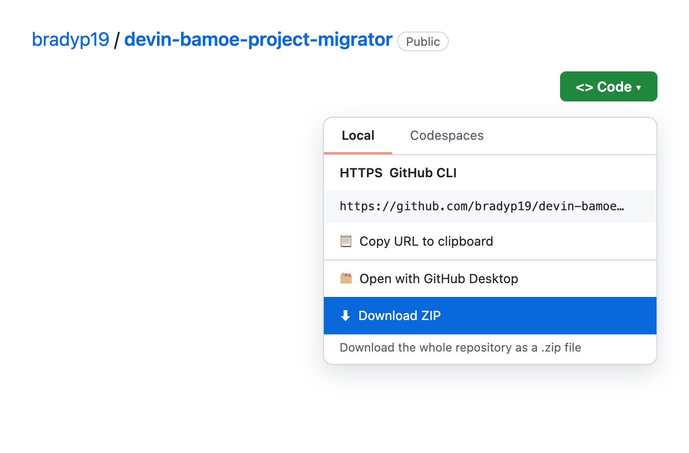

> **Important:** do *not* unzip the file. Devin wants the zip exactly as it is.

### Step 2. Open Devin in your browser

1. Go to `app.devin.ai`.
2. Sign in the way your team normally does.

### Step 3. Open the Customize panel

Look at the **far-left edge of the screen**. There is a narrow column of buttons
(New session, Automations, Security, Review, Wiki…). Find the one that says
**Customize** and click it:

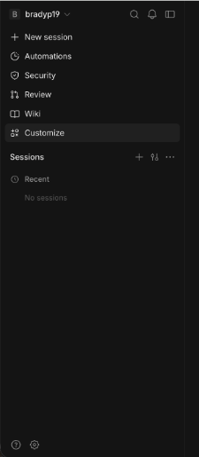

### Step 4. Open the Plugins tab

Near the top of the screen you will see a row of tabs:
**Plugins · Skills · MCPs · Hooks · Rules · Memory**.

Click **Plugins**.

You should now see the Plugins page. Since nothing is installed yet, the
**Installed** list is empty — look for the **+ Add plugin** button in the
top-right corner (highlighted here):

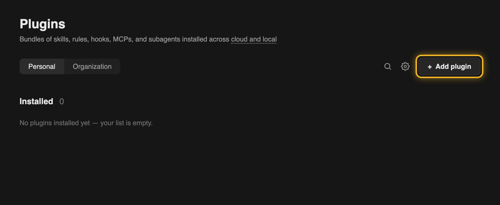

### Step 5. Install the plugin

1. Click **+ Add plugin** (top-right corner).
2. A file picker window opens. Find the zip file from Step 1 — probably in your
   **Downloads** folder. Click the zip file once so it's highlighted, then click
   **Upload** (or **Open** — the word depends on your computer):

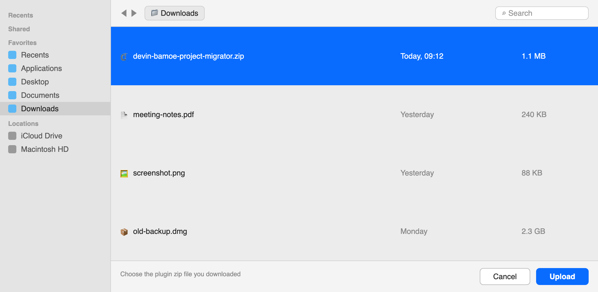

### Step 6. Check that it worked

Back on the Plugins page, you should now see a card that says
**Bamoe Migrator** with a green **Installed** label:

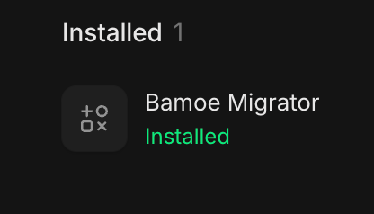

If you see that green "Installed", the plugin is in. If you don't, stop here and
ask your BAMOE administrator for help — nothing else will work until this shows
"Installed".

### Step 7. Check that all 8 skills arrived

The plugin comes with **8 skills** — think of them as 8 little instruction
booklets that teach Devin how to do each part of the migration.

1. Click the **Skills** tab (same row of tabs as before, right next to Plugins).
2. It should say **Installed 8** and show a **Bamoe Migrator** entry:

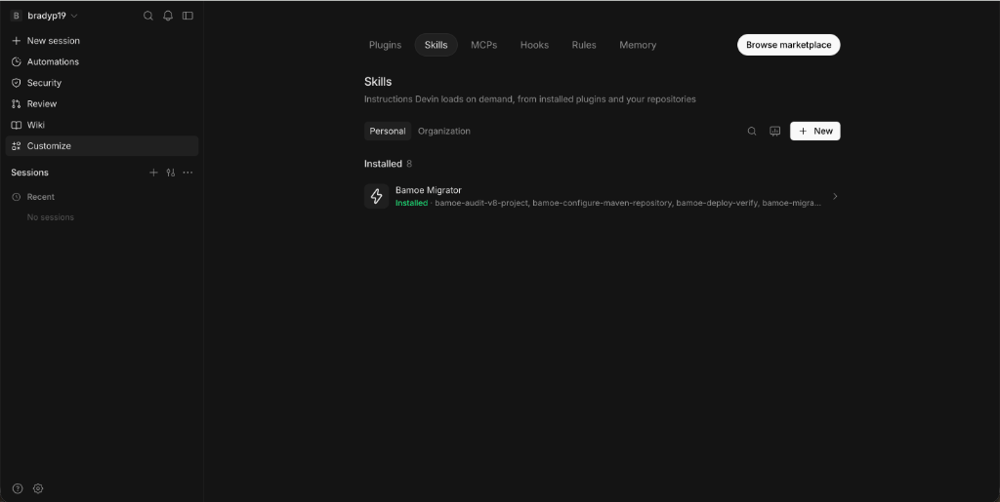

3. Click the **Bamoe Migrator** row to open it. You should see all 8 skills:

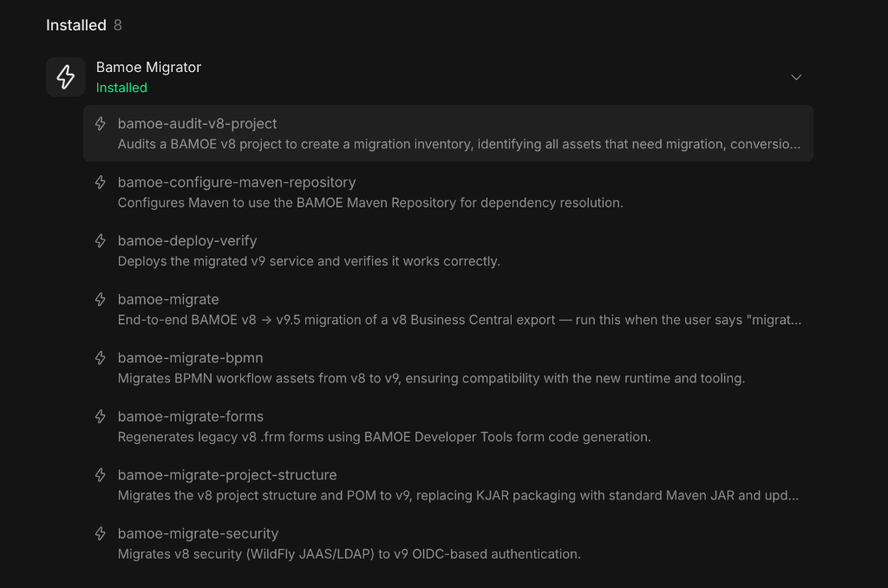

They are: `bamoe-audit-v8-project`, `bamoe-configure-maven-repository`,
`bamoe-deploy-verify`, `bamoe-migrate`, `bamoe-migrate-bpmn`,
`bamoe-migrate-forms`, `bamoe-migrate-project-structure`, `bamoe-migrate-security`.

### Step 8. Start a new session

1. Click **New session** at the top of the left sidebar (or the **+** next to
   "Sessions").
2. A chat box opens in the middle of the screen — the one that says
   *"Ask Devin to build features, fix bugs, or work on your code"*:

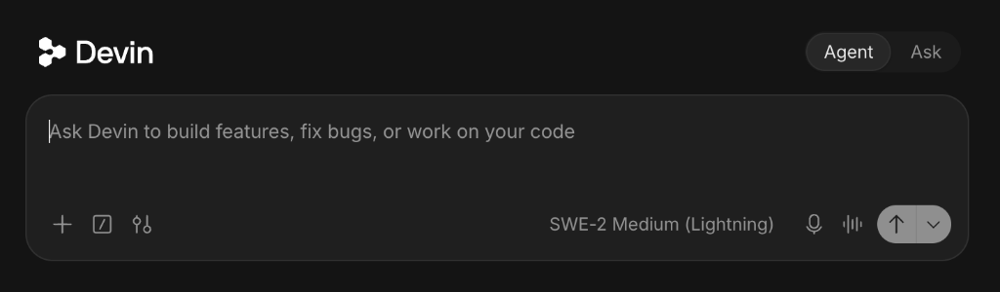

### Step 9. Upload your v8 project

1. In the chat box, click the **+** (plus) icon on the **bottom-left**.
2. A small menu pops up — click **Upload Folder**:

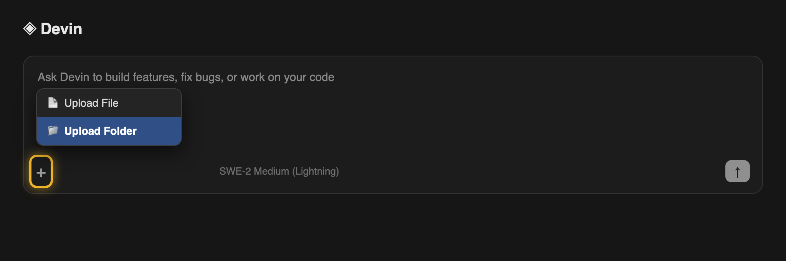
3. Your computer's file window opens. Find the folder that holds your old v8
   project (it might be called `v8-app`, or whatever your team named it).
   Click that folder **once**, then click **Upload**:

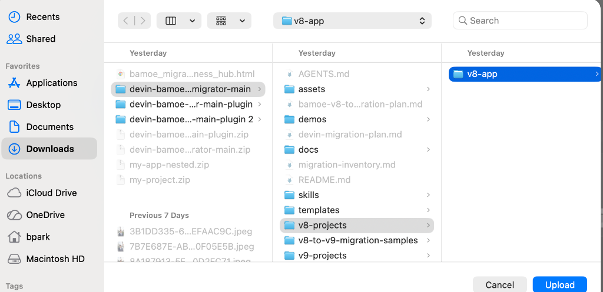

> **What folder is the right one?** The right folder has a file called `pom.xml`
> sitting at its top level, and a `src/` folder inside it. That's a v8 Business
> Central project export — see [What goes in](#what-goes-in) below if you're not
> sure.
>
> **Where should it go?** Ideally into the `v8-projects/` folder in the workspace.
> If it lands somewhere else, don't worry — after you send your message in the
> next step, Devin will move it into `v8-projects/` itself. You can also just
> tell Devin *"move v8-app into v8-projects/"*.

### Step 10. Say the magic words

In the chat box, type exactly this and press **Enter**:

```
Migrate my project
```

That's the entire instruction. Devin now works through 10 migration steps on its
own — see [What you will see](#what-you-will-see) below for what it looks like
while it runs.

### Step 11. Wait for it to finish

- Devin shows its work as it goes: which files it found, which it's converting,
  and a checklist file called `migration-status.md` that ticks off each step.
- When it's done, it posts a summary in the chat: what it found, what it
  created, and the few things a human still needs to do.
- The finished project lives in `v9-projects/<your-project-name>/` in the
  session's workspace.

### Step 12. Get your migrated project out

- Ask Devin: *"zip up v9-projects/ so I can download it"* — it will produce a
  downloadable zip in the session.
- Or, if the session is attached to your repository, the new files can be
  committed back to GitHub for you.

> **Seeing `Build: not-run`?** That's normal on the web version — the IBM build
> repository is private, so Devin can't compile the project there. The converted
> files are still complete. For a verified build, see
> [docs/engineers/local-maven-repo.md](docs/engineers/local-maven-repo.md).

### Step 13. Check that the migration is correct

Once you have a `v9-projects/<your-project-name>/` folder, ask Devin:

```
validate my project
```

Devin runs its built-in validation script in its own shell — no terminal needed
from you. It checks that the migrated project has everything the v9.5 contract
requires (and nothing v8 left behind), then reports the results and records any
findings in `migration-status.md`.

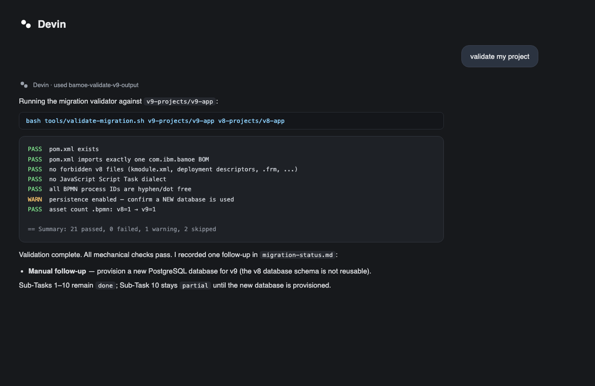

- **Green PASS lines** mean the mechanical checks succeeded.
- **WARN lines** are things worth confirming by hand (for example, "did we get a
  new database?").
- **FAIL lines** mean part of the migration is incomplete — Devin marks the
  affected step `partial` in `migration-status.md` and lists the exact fix under
  "Manual follow-ups / known gaps".

The full contract Devin validates against lives in
[`docs/migration-output-contract.md`](docs/migration-output-contract.md).

---

## Section 2 — Devin on the desktop

The desktop flow is the same journey — the buttons are just in the app instead
of the browser. **No command line needed, ever.**

### Step 1. Get the zip file

Same as [Section 1, Step 1](#step-1-get-the-zip-file): either someone sent you
`devin-bamoe-project-migrator.zip`, or you download it from the GitHub
repository page with **Code → Download ZIP**. Keep it zipped.

### Step 2. Open the Devin desktop app

Launch the Devin app on your computer and sign in the way your team normally
does.

### Step 3. Install the plugin

This is exactly the same as the web version — follow
[Section 1, Steps 3–6](#step-3-open-the-customize-panel):

1. Click **Customize** in the left sidebar.
2. Click the **Plugins** tab.
3. Click **+ Add plugin** (top-right).
4. Pick the zip file and click **Upload**.
5. Confirm you see **Bamoe Migrator** with a green **Installed** label
   ([see the screenshot](#step-6-check-that-it-worked)).

### Step 4. Check the 8 skills

Click the **Skills** tab — it should say **Installed 8** and show all 8
`bamoe-*` skills ([see the screenshots](#step-7-check-that-all-8-skills-arrived)).

### Step 5. Open your working folder

Open (or create) the folder where you want the migration to happen — for example,
the cloned repository, or any empty folder on your computer. The plugin is
installed for you, not for one folder, so any working folder works.

### Step 6. Drop in your v8 project

Using your file manager (Finder on Mac, Explorer on Windows):

1. Inside your working folder, create a folder named `v8-projects` if it isn't
   there already.
2. Drag your exported v8 project folder into `v8-projects/`. It should end up as
   `v8-projects/<your-project>/pom.xml`.

Or, if you prefer, start a session and use the **+** → **Upload Folder** button
in the chat box exactly as shown in
[Section 1, Step 9](#step-9-upload-your-v8-project) — Devin will place it in
`v8-projects/` for you.

### Step 7. Say the magic words

Open a **New session** in the desktop app, type exactly:

```
Migrate my project
```

and press **Enter**.

### Step 8. Collect the result

The migrated project appears at `v9-projects/<your-project-name>/` right in your
working folder — real files on your machine, nothing to download. Watch
`migration-status.md` inside it for the step-by-step checklist.

> On the desktop, `Build: not-run` is still the default unless your
> administrator has set up the IBM Maven repository — see
> [docs/engineers/local-maven-repo.md](docs/engineers/local-maven-repo.md).

### Step 9. Check that the migration is correct

Same as [Section 1, Step 13](#step-13-check-that-the-migration-is-correct): type
`validate my project` in the session and Devin validates the `v9-projects/`
output against the expected-output contract, reporting PASS/WARN/FAIL results
and updating `migration-status.md` with any follow-ups.

---

## Don't have a v8 export to practice with?

The `v8-projects/` folder ships **empty on purpose** — you bring your own export.
If you just want to try the migration end-to-end, copy a sample into place first,
for example:

```
v8-to-v9-migration-samples/tutorial-01-evaluation-process/v8-app/  →  v8-projects/v8-app/
```

(To export your real project: in Business Central, open the project and use
**Export** — or ask your BAMOE administrator for a zip of the project.)

---

## What goes in

A correct input looks exactly like this:

```
v8-projects/
└── my-project/                               ← any name; a .zip is fine too
    ├── pom.xml                               ← MUST be right here, not one folder deeper
    └── src/
        └── main/
            ├── java/                         ← your Java classes (may be empty)
            └── resources/
                ├── *.bpmn                    ← your process diagrams
                ├── *.dmn  *.drl  *.frm       ← decisions, rules, forms (optional)
                └── META-INF/
                    ├── kmodule.xml           ← normal in v8; will be removed in v9
                    ├── kie-deployment-descriptor.xml
                    └── persistence.xml
```

If your folder looks like this, you're good. If you're not sure, just put it in and ask Devin: *"Is my project in the right place?"*

---

## What comes out

```
v9-projects/
└── my-project/
    ├── pom.xml                               ← new; Quarkus + Kogito
    ├── migration-inventory.md                ← everything Devin found in your v8 project
    ├── migration-status.md                   ← the 10 steps, ticked off as they finish
    └── src/main/
        ├── java/…                            ← updated Java (jakarta.*, new handlers)
        └── resources/
            ├── application.properties        ← replaces all the META-INF xml files
            ├── *.bpmn                        ← upgraded diagrams, Java scripts
            └── custom-forms-dev/*.tsx        ← regenerated forms (if you had .frm files)
```

---

## What you will see

Devin works through 10 steps. Here's what each one looks like in plain language:

| Step | What Devin says it's doing | What appears | Typical time |
|---|---|---|---|
| 1 | "Auditing your v8 project" | `migration-inventory.md` — a list of everything found | 1–2 min |
| 2 | "Creating the new v9 project structure" | `v9-projects/<name>/pom.xml` + `application.properties` | 1–2 min |
| 3 | "Reading your process diagrams and rewriting any JavaScript inside them as Java" | upgraded `.bpmn` files | 2–5 min |
| 4 | "Checking decision models (DMN)" | upgraded `.dmn` files, or "skipped — none found" | 0–3 min |
| 5 | "Checking rules and test scenarios" | converted `.drl`/`.scesim` files, or "skipped" | 0–3 min |
| 6 | "Updating your custom Java work handlers" | rewritten Java classes, or "skipped" | 0–5 min |
| 7 | "Moving security settings to the new login system" | security lines in `application.properties` | 1–3 min |
| 8 | "Regenerating your forms" | new `.tsx` form files under `custom-forms-dev/` | 2–5 min |
| 9 | "Checking event listeners and messaging" | listener classes / Kafka properties, or "skipped" | 0–3 min |
| 10 | "Writing down how to go live" | deployment notes for the new version | 1–2 min |

At the end Devin posts a summary like:

```
Done! I migrated your project "my-project" from BAMOE v8 to v9.5.

Found:      2 processes, 3 forms, 1 rule file, 0 decision models.
Created:    v9-projects/my-project/  (see migration-status.md for what was done)
To do by hand:
  - Open the regenerated forms in BAMOE Developer Tools for VS Code and check the layout.
  - Your v8 database cannot be reused — the deployment notes explain the side-by-side switchover.
```

On the Devin website Devin cannot run the IBM build tool, so `Build: not-run` is normal. The converted files are still complete. If you want a verified build, see [docs/engineers/local-maven-repo.md](docs/engineers/local-maven-repo.md).

---

## Common pitfalls

| What you see | Why | Fix |
|---|---|---|
| I uploaded a .zip | That's fine — Devin unzips it automatically | Nothing. If Devin says it can't find `pom.xml`, the zip probably contains a folder inside a folder; Devin fixes that too. Otherwise unzip it yourself and put the inner folder in `v8-projects/` |
| "I can't find pom.xml" | The folder is in the wrong place (repo root, `v9-projects/`, or nested twice) | Move it so `v8-projects/<name>/pom.xml` exists |
| Folder name has spaces ("my app copy") | Spaces break some tools | Devin renames it with hyphens; prefer no spaces next time |
| Only a .bpmn file, no pom.xml | A single diagram is not a project export | In Business Central use **Export** (or git clone the project) so you get `pom.xml` + `src/` |
| Two folders in `v8-projects/` | Devin doesn't know which to migrate | It will ask. Say "all" or a name |
| "Build: not-run" | Expected on the Devin website — the IBM build repo is private | Nothing; the files are complete. See the engineers' appendix for a local verified build |
| Forms look missing | `.frm` forms can't be converted automatically | Devin generates new ones you may need to open and tweak in BAMOE Developer Tools for VS Code |
| Devin asks a question and waits | It only asks when it truly can't decide | Just answer in plain words |
| No green "Installed" after uploading the plugin zip | The upload didn't finish, or the wrong file was picked | Re-do Section 1 Step 5 with the zip from Step 1 — don't unzip it first |
| Skills tab shows fewer than 8 | The plugin didn't fully install | Remove and reinstall the plugin, then recheck |

---

## Video tutorial

Watch the end-to-end tutorial: [Migrate my project — BAMOE v8 → v9.5 on Devin](https://youtu.be/hioFbZQwGvo).

The video follows [docs/tutorial/video-script.md](docs/tutorial/video-script.md) and is produced with Remotion — see [docs/tutorial/remotion/](docs/tutorial/remotion/).

---
---

## Details for engineers

Everything below is the technical reference. Non-engineers can stop here.

### Optional: install via the Devin CLI

If you have the Devin CLI (not required — the steps above never need it):

```
devin plugins install bradyp19/devin-bamoe-project-migrator
```

Working on the plugin itself? `devin plugins install --local .` from a checkout links it live.

### The migration plan at a glance

The full plan lives in [`bamoe-v8-to-v9-migration-plan.md`](bamoe-v8-to-v9-migration-plan.md) — a read-only template. Per-project progress is tracked in `v9-projects/<name>/migration-status.md`.

```
Sub-Task 1     Audit v8 project — classify every asset as Migrate as-is /
               Requires manual update / Must replace. Produce migration-inventory.md.

Sub-Task 2     Migrate project structure and pom.xml — replace RHPAM BOM with
               Kogito + Quarkus BOM; delete v8-only config files; create
               application.properties skeleton.

Sub-Task 3     Migrate BPMN workflow assets — trigger XML upgrade via tooling;
               replace JavaScript scripting with Java; replace DROOLS gateway
               expressions; refactor shared KIE-session patterns; fix process IDs.

Sub-Task 4     Migrate DMN decision assets — upgrade to DMN 1.6; remove PMML
               references; recreate Java-backed types via Developer Tools.

Sub-Task 5     Migrate DRL rules, decision tables, test scenarios — convert
               Guided Rules / DSL / Scorecards to DRL or DMN; update JUnit
               activator to @TestScenarioActivator (JUnit 5).

Sub-Task 6     Migrate custom WorkItemHandlers — new API, new registration
               mechanism, remove @Wid annotations, reconfigure retry logic.

Sub-Task 7     Migrate security, auth, UserGroupCallback, AssignmentStrategy —
               WildFly/JAAS replaced by OIDC; UserGroupCallback replaced by
               IdentityProvider; AssignmentStrategy replaced by
               UserTaskAssignmentStrategy.

Sub-Task 8     Migrate forms — v8 .frm files are incompatible; regenerate all
               forms using Developer Tools "Generate form code for User Task".

Sub-Task 9     Migrate event streaming and event listeners — TaskLifeCycleEventListener
               replaced by UserTaskEventListener; Kafka reconfigured via
               mp.messaging.* / spring.kafka.* properties.

Sub-Task 10    Runtime deployment and live-data cutover — deploy v9 service;
               provision a new database (schemas are incompatible); run v8 and
               v9 in parallel; route new instances to v9; decommission v8 once
               all in-flight instances complete.
```

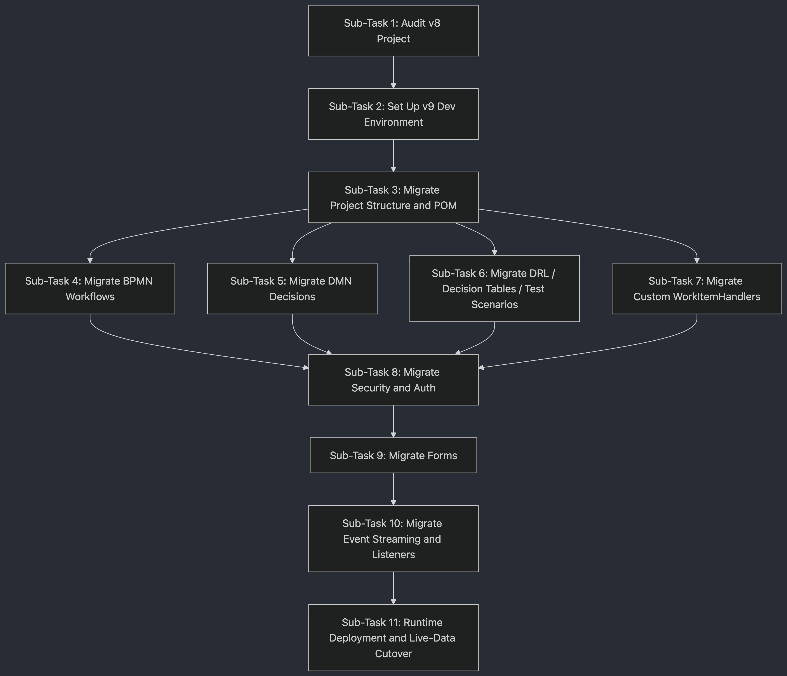

### Repository layout

```
devin-bamoe-project-migrator/
├── v8-projects/                  # Your v8 exports go here (input — ships empty)
├── v9-projects/                  # Migrated v9 projects appear here (output)
│   └── <name>/
│       ├── migration-inventory.md
│       └── migration-status.md
├── v8-to-v9-migration-samples/   # Reference tutorials with working v8 + v9 pairs
├── docs/
│   ├── images/                   # README diagrams + setup screenshots
│   ├── engineers/                # Local build / Maven repo appendix
│   └── tutorial/                 # Video script for the walkthrough
├── templates/                    # settings.xml + migration-status.md templates
├── demos/                        # Recorded demo videos
├── skills/                       # Devin plugin skills used during migration
├── .devin-plugin/                # Devin plugin manifest (plugin.json)
├── bamoe-v8-to-v9-migration-plan.md   # The 10-sub-task plan (read-only template)
├── AGENTS.md                     # Devin's operating instructions
└── README.md                     # This file
```

### How the agent works

`AGENTS.md` instructs Devin to:

1. **Find and normalize the input** in `v8-projects/` (unzip, flatten nested folders, rename folders with spaces).
2. **Fetch the exact BAMOE 9.5.x doc page** for each conversion step before touching any file — every sub-task carries a Knowledge Sources table linking the authoritative `.adoc`.
3. **Run all 10 sub-tasks in order** without waiting for approval between them, recording each result in `v9-projects/<name>/migration-status.md`.
4. **Never block on the private IBM Maven repository.** On Devin web the default is Convert-only (`Build: not-run`). Set the `BAMOE_MAVEN_REPO_URL` secret to switch to Convert + verify mode (see `templates/settings.xml` and `docs/engineers/local-maven-repo.md`).
5. **Enforce 17 non-negotiable conversion rules** derived from the official upgrade guides.

### Knowledge source grounding

The base URL pattern for the official docs is:

```
https://raw.githubusercontent.com/IBM/bamoe-docs/9.5.x/<section>/<file>.adoc
```

The full documentation navigation tree is at:

```
https://raw.githubusercontent.com/IBM/bamoe-docs/9.5.x/nav.adoc
```

### Non-negotiable conversion rules

| Rule | v8 | v9.5 |
|---|---|---|
| Config files | `kmodule.xml`, `kie-deployment-descriptor.xml`, `persistence.xml` | **Deleted** — replaced by `application.properties` |
| Property namespace | `kieserver.*`, `drools.*`, `jbpm.*` | **Replaced** by `kogito.*` |
| Script Task language | JavaScript supported | **Java only** |
| Gateway expressions | DROOLS expressions supported | **Java expressions only** |
| BPMN + DRL session | Shared KIE session (`insert`/`retract` across boundary) | **Not supported** — use Input/Output data mapping |
| Process IDs | Hyphens and dots allowed | **Must be camelCase** (hyphens/dots break codegen) |
| PMML | Supported | **Not supported** — replace with DMN or external ML |
| Guided Rules / DSL / Scorecards | Supported | **Must convert** to DRL or DMN |
| Forms | `.frm` files | **Incompatible** — regenerate via Developer Tools |
| WIH interface | `implements WorkItemHandler` | `extends DefaultKogitoWorkItemHandler` |
| WIH lifecycle methods | `executeWorkItem` / `abortWorkItem` | `activateWorkItemHandler` / `abortWorkItemHandler` |
| WIH registration | `kie-deployment-descriptor.xml` | `@ApplicationScoped` `DefaultWorkItemHandlerConfig` bean |
| `@Wid` annotation | Used on WIH classes | **Removed** — `.wid` files kept |
| Auth / identity | WildFly JAAS, `UserGroupCallback`, LDAP | **OIDC** via `IdentityProvider` |
| Task event listener | `TaskLifeCycleEventListener` before/after callbacks | `UserTaskEventListener` single-callback `onUserTaskState` |
| Database | Shared across versions | **New DB required** — side-by-side parallel run only |
| Java packages | `javax.*` | **`jakarta.*`** |

### Architecture: before and after

```
BAMOE v8                              BAMOE v9.5
------------------------------------  ------------------------------------
Business Central (authoring +         BAMOE Canvas (business-analyst UI)
  internal Git + Maven)               BAMOE Developer Tools for VS Code
                                      External Git (GitHub / GitLab / Bitbucket)
                                      BAMOE Maven Repository (container / local)

KIE Server (KJAR deployment,          Kogito microservice embedded in
  centralised runtime)                  Quarkus 3.x or Spring Boot 3.x
                                        Deployed as container image / Uber-JAR

Smart Router (load balancing)         Kubernetes-native load balancing

Business Central Monitoring           BAMOE Management Console (Helm chart)
                                      + Data-Index GraphQL API
                                      + Prometheus / Grafana

WildFly / JBoss EAP                   Standard JVM / container runtime
JAAS / LDAP authentication            OIDC (Keycloak or any compliant IdP)
kmodule.xml + XML descriptors         pom.xml + application.properties only
Java 8 or 11 / Maven 3.6.x            Java 21 / Maven 3.9.11+
```

### Available skills

The following skills live in `skills/` and are installed with the plugin (invoke them as `/bamoe-migrator:<skill-name>` when installed):

| Skill | Purpose | Sub-Task |
|---|---|---|
| `bamoe-migrate` | One-prompt end-to-end migration (runs all sub-tasks) | All |
| `bamoe-audit-v8-project` | Audits v8 project and creates migration-inventory.md | Sub-Task 1 |
| `bamoe-configure-maven-repository` | Configures Maven to use BAMOE Maven Repository | Prerequisite |
| `bamoe-migrate-project-structure` | Migrates project structure and POM from v8 to v9 | Sub-Task 2 |
| `bamoe-migrate-bpmn` | Migrates BPMN workflow assets and upgrades XML | Sub-Task 3 |
| `bamoe-migrate-forms` | Regenerates .frm forms using Developer Tools | Sub-Task 8 |
| `bamoe-migrate-security` | Migrates security from JAAS to OIDC | Sub-Task 7 |
| `bamoe-deploy-verify` | Deploys and verifies the migrated v9 service | Sub-Task 10 |
| `bamoe-validate-v9-output` | Validates a migrated v9 project against `docs/migration-output-contract.md` and records findings in `migration-status.md` | Any time |

To check a finished migration, just ask Devin to "validate my project" — no terminal needed.
The agent runs `tools/validate-migration.sh` for you and reports findings in plain language.

### References

| Resource | URL |
|---|---|
| BAMOE 9.5.x documentation tree | https://github.com/IBM/bamoe-docs/blob/9.5.x/nav.adoc |
| Upgrade overview | https://raw.githubusercontent.com/IBM/bamoe-docs/9.5.x/upgrade/upgrading-80x-current.adoc |
| Key differences v8 vs v9 | https://raw.githubusercontent.com/IBM/bamoe-docs/9.5.x/upgrade/02-key-differences.adoc |
| Not supported in v9.5 | https://raw.githubusercontent.com/IBM/bamoe-docs/9.5.x/upgrade/11-not-supported.adoc |
| BAMOE Canvas Quarkus Accelerator | https://github.com/IBM/bamoe-canvas-quarkus-accelerator |
| Local build appendix (engineers) | [docs/engineers/local-maven-repo.md](docs/engineers/local-maven-repo.md) |
