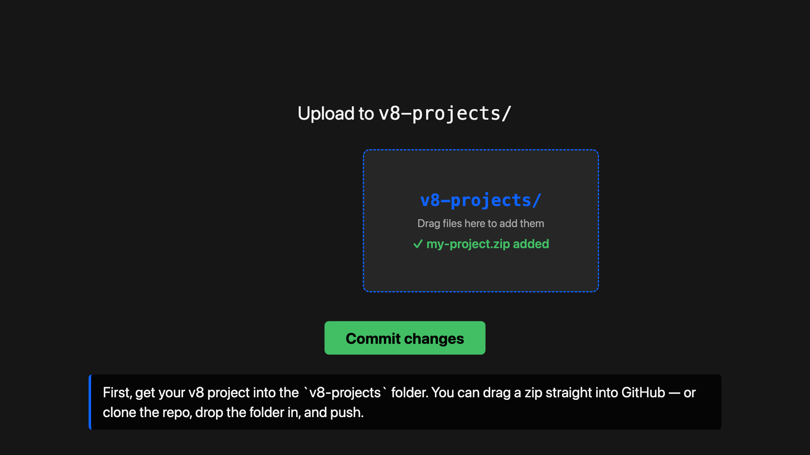
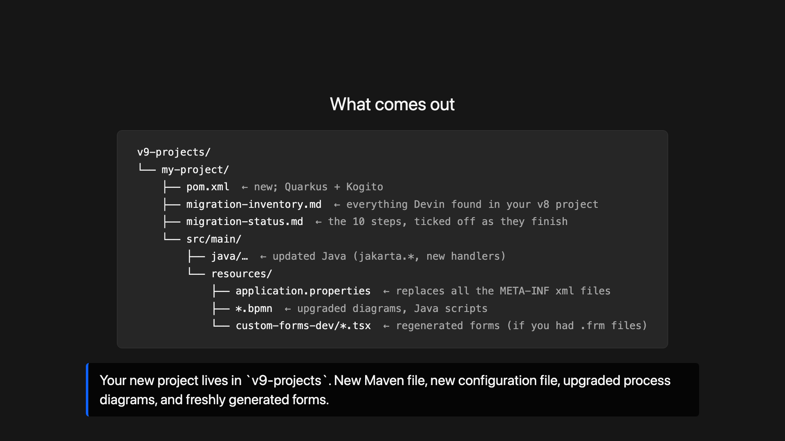
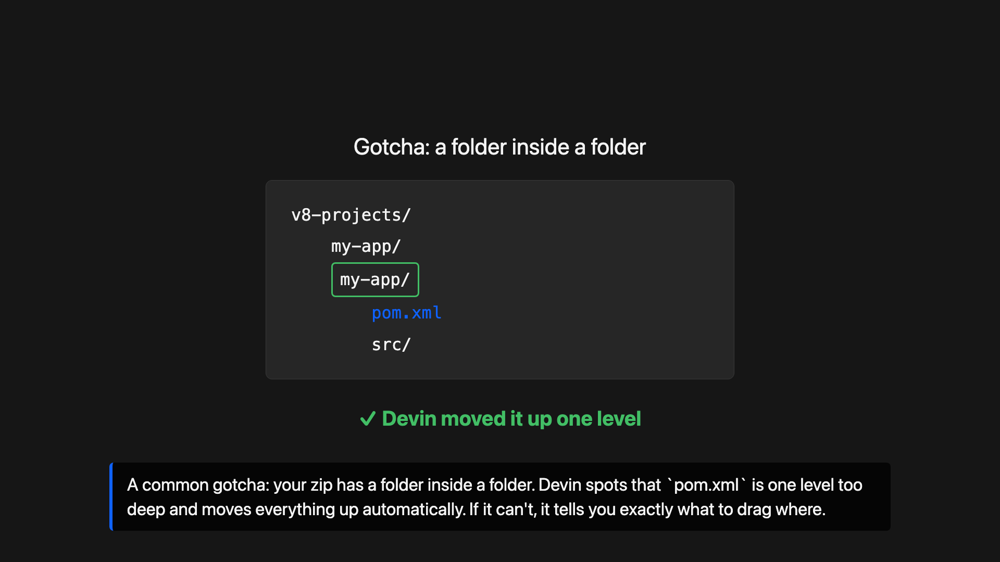

# Tutorial video (Remotion)

Renders the ~2.5 minute tutorial defined in `../video-script.md` as a hybrid video:
animated "synthetic" shots for everything except the four real screen recordings,
which are dropped in as `public/raw/shot-0N.mp4` files.

## Requirements

- Node.js 18+

## Install

```bash
npm install
```

## Preview (Remotion Studio)

```bash
npm run dev
```

Opens Remotion Studio in your browser — scrub through the `BamoeMigratorTutorial`
composition (1920×1080, 30 fps, 4230 frames / 141 s).

## Render

```bash
npm run build
```

Writes `out/tutorial.mp4` (H.264, 1920×1080, 30 fps).

## Recording the 4 real shots

Shots 3–6 are placeholders until you drop real screen recordings into
`public/raw/`. Record at **1920×1080** — no audio needed (there is no audio track).

| Shot | Save as | What to show | Target length |
|---|---|---|---|
| 3 | `public/raw/shot-03.mp4` | Empty Devin session chat box; type `Migrate my project` and hit Enter | ~8 s |
| 4 | `public/raw/shot-04.mp4` | Devin's terminal / file view; time-lapse of Devin unzipping, listing `v8-projects/`, finding `pom.xml` | ~20 s |
| 5 | `public/raw/shot-05.mp4` | `v9-projects/v9-app/migration-status.md` open; rows flipping `[ ] pending` → `[x] done` / `[x] skipped` | ~20 s |
| 6 | `public/raw/shot-06.mp4` | Devin chat showing the final summary message; scroll through it | ~15 s |

**Placeholder behaviour:** if a `raw/shot-0N.mp4` file is missing, the video
renders a "Recording pending — shot N" card (with the shot's Screen + Action
notes) instead of crashing — so you can render the whole video before recording
anything. The check uses `getStaticFiles()` at render time, so just drop the file
in and re-render; no code changes needed.

## Preview

Still frames from the synthetic shots (in `preview/`):

| Shot | Preview |
|---|---|
| 1 — upload to `v8-projects/` |  |
| 7 — the "What comes out" tree |  |
| 8 — nested-folder self-fix |  |

## Layout

```
src/script.ts     shot list data (id, kind, duration, caption, rawFile)
src/Root.tsx      composition: TransitionSeries + 15-frame cross-fades
src/style.ts      shared colours / fonts
src/shots/        one component per shot + shared Caption subtitle bar
public/raw/       real screen recordings go here
```
